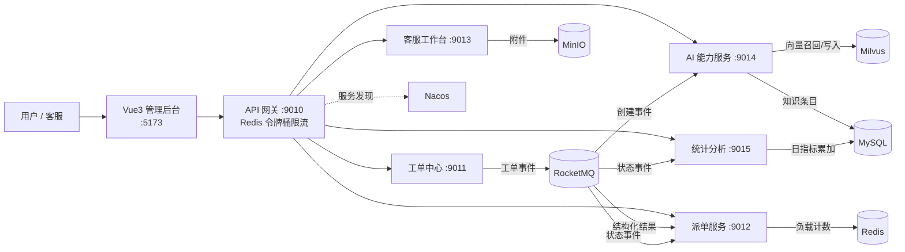

# 智能售后工单全链路调度与处理 Agent 系统

一个面向电商售后场景的微服务项目：用户提交工单后，系统自动完成 **AI 结构化 → 异常预警 → 智能派单 → 客服处理 → AI 回复草稿 → 统计看板** 的全链路闭环，并提供企业级 Web 管理后台。

后端 Spring Cloud 微服务 + 前端 Vue3 + 中间件 MySQL / Redis / Nacos / RocketMQ / Milvus / MinIO。

---

## 一、系统架构



**微服务职责**

| 模块 | 端口 | 职责 |
| --- | --- | --- |
| `api-gateway` | 9010 | 统一入口、路由转发、Redis 令牌桶限流、统一错误响应 |
| `work-order-service` | 9011 | 工单主表/详情/日志、状态机流转、事务提交后发 MQ 事件 |
| `dispatch-service` | 9012 | 客服档案、派单策略（随机/技能/最小负载/加权）、Redis 负载统计、超时自动转派 |
| `workbench-service` | 9013 | 客服工作台聚合接口、领取/回复/解决/转交/关闭、MinIO 附件上传 |
| `ai-service` | 9014 | 结构化提取 Agent、预警评估 Agent、RAG 回复 Agent、知识库向量同步 |
| `stats-service` | 9015 | 消费 MQ 事件异步累加日指标，提供看板四接口 |
| `after-sales-common` | - | 统一返回体 `Result`/`PageResult`、状态枚举、MQ 常量、全局异常处理 |

---

## 二、功能特性

- **AI 结构化提取**：大模型从诉求原文抽取工单类型、优先级、金额、投诉意向、关联订单号；模型返回非法枚举时用关键词规则做最终校正
- **异常预警**：关键词 / 重复诉求 / 超时未处理 / 高金额 / 投诉情绪五类规则，配置存库、启停热生效，命中可自动升级 `URGENT`
- **智能派单**：四种策略可热切换；加权策略综合技能匹配、当前负载、历史解决率、在线时长
- **负载与超时治理**：Redis 实时负载计数；超时未处理自动转派
- **RAG 回复草稿**：诉求文本向量化 → Milvus 语义召回 → Prompt 组装 → 大模型生成草稿，客服审核后发送
- **统计看板**：MQ 事件异步累加 `work_order_metrics_daily`，今日概览、近 7 天趋势、类型分布、客服实时负载
- **稳定性**：网关限流返回统一 429；Feign + Resilience4j 熔断降级，下游不可用时返回可读提示
- **企业级前端**：深色侧栏布局、工单全流程操作、ECharts 看板、30 秒自动刷新

---

## 三、技术栈

**后端**：JDK 17 · Spring Boot 3.2.4 · Spring Cloud 2023.0.1 · Spring Cloud Alibaba 2023.0.1.0 · OpenFeign · Resilience4j · MyBatis-Plus 3.5.7 · RocketMQ 5.3.0 · Milvus 2.5.4 · MinIO 8.5.17 · LangChain4j 0.36.2 · Knife4j 4.5.0

**前端**：Vue 3 · Vite 5 · Vue Router 4 · Pinia · Element Plus · ECharts 5 · Axios

**中间件**：MySQL 8 · Redis 7 · Nacos 2.4.3 · RocketMQ 5.3.0 · Milvus 2.5.4 · MinIO

---

## 四、快速开始

### 1. 启动中间件

```bash
cd deploy/docker
docker compose up -d
```

首次启动会自动执行 `deploy/docker/mysql/init/01-schema.sql` 建库建表。

| 组件 | 访问地址 | 账号 |
| --- | --- | --- |
| MySQL | `localhost:3307` | `root / root123` |
| Redis | `localhost:6379` | 无密码 |
| Nacos 控制台 | http://localhost:8848/nacos | 已关闭鉴权 |
| RocketMQ 控制台 | http://localhost:8080 | 无 |
| MinIO 控制台 | http://localhost:9002 | `minioadmin / minioadmin123` |
| Milvus | `localhost:19530` | - |

### 2. 配置大模型密钥

`ai-service` 通过环境变量读取密钥：

```powershell
# Windows PowerShell（写入用户级环境变量，需重新打开终端生效）
setx AI_API_KEY "你的 DashScope API Key"

# macOS / Linux
export AI_API_KEY="你的 DashScope API Key"
```

相关配置见 `ai-service/src/main/resources/application.yml`：

- 对话模型：OpenAI 兼容端点 `https://dashscope.aliyuncs.com/compatible-mode/v1`，默认模型 `deepseek-v4.1-flash-1017`
- 向量模型：`text-embedding-v3`，1024 维
- 无 Key 想先跑通流程：把 `ai.chat.mock-enabled` 与 `ai.embedding.mock-enabled` 置为 `true`，使用内置 Mock 客户端

### 3. 编译并启动后端

```bash
# 项目根目录
mvn -q -DskipTests clean package

# 按顺序启动（每个服务一个终端）
java -jar api-gateway/target/api-gateway-1.0.0.jar
java -jar work-order-service/target/work-order-service-1.0.0.jar
java -jar dispatch-service/target/dispatch-service-1.0.0.jar
java -jar workbench-service/target/workbench-service-1.0.0.jar
java -jar ai-service/target/ai-service-1.0.0.jar
java -jar stats-service/target/stats-service-1.0.0.jar
```

### 4. 启动前端

```bash
cd frontend
npm install
npm run dev
```

浏览器打开 **http://localhost:5173** （开发服务器已把 `/api` 代理到网关 9010，无跨域问题）。

### 5. 接口文档

每个服务自带 Knife4j：`http://localhost:9011/doc.html`、`9012`、`9013`、`9014`、`9015`。

---

## 五、核心链路示例

通过网关创建一张投诉工单：

```bash
curl -X POST http://localhost:9010/work-order/create \
  -H "Content-Type: application/json" \
  -d '{
    "userId": 1005,
    "userName": "张三",
    "sourceChannel": "WEB",
    "content": "电饭煲煮饭夹生，我要投诉，要求退货退款！订单号 EC20261019012",
    "relatedOrderId": "EC20261019012"
  }'
```

随后（约 10 秒内）：

1. `ai-service` 消费创建事件 → 大模型结构化 → 回写 `COMPLAINT / HIGH / complaintIntent=true`
2. 预警 Agent 命中投诉关键词 → 工单升级 `priority=URGENT`
3. `dispatch-service` 按加权策略派单 → 工单进入 `PENDING_HANDLE`
4. 客服在工作台领取 → AI 生成回复草稿 → 回复 → 标记解决
5. `stats-service` 异步累加当日指标，前端看板实时可见

---

## 六、关键设计

- **事件顺序**：工单变更在数据库事务 `afterCommit` 后才发送 MQ，避免「消息已消费、本地事务回滚」的脏数据
- **状态机收敛**：所有流转经 `WorkOrderStateMachine` 校验，非法跃迁直接拒绝
- **并发丢失更新**：派单、升级、结构化回写统一使用 `LambdaUpdateWrapper` 列级定向更新，避免整行回写覆盖并发写入的字段
- **统计幂等**：事件按 `eventId` 在 Redis 去重 24 小时；平均解决时长用增量加权平均
- **限流**：网关 `RequestRateLimiter` 令牌桶存 Redis，按客户端 IP 分桶，阈值可用环境变量 `GATEWAY_RATE_REPLENISH` / `GATEWAY_RATE_BURST` 调整
- **熔断**：Feign 配置正确前缀为 `spring.cloud.openfeign.*`；AI 调用单独放宽 Feign 读超时与 Resilience4j TimeLimiter（默认 1 秒会误判真实大模型调用为超时）

---

## 七、目录结构

```
.
├── after-sales-common/      # 公共返回体、枚举、MQ 常量、全局异常
├── api-gateway/             # 网关（路由 + 限流 + 统一异常响应）
├── work-order-service/      # 工单中心
├── dispatch-service/        # 派单与客服管理
├── workbench-service/       # 客服工作台 + 附件
├── ai-service/              # AI Agent 与知识库
├── stats-service/           # 统计分析看板
├── frontend/                # Vue3 企业级管理后台
├── deploy/docker/           # 中间件 docker-compose 与初始化 SQL
└── pom.xml                  # Maven 聚合工程
```

---

## 八、说明与限制

- 项目**未接入登录鉴权**：前端通过顶栏切换客服身份模拟登录态
- 中间件口令（MySQL / MinIO）为演示默认值，生产部署请改为环境变量注入
- 大模型与向量模型需要有效 API Key；无 Key 时可用 Mock 模式完整体验流程
